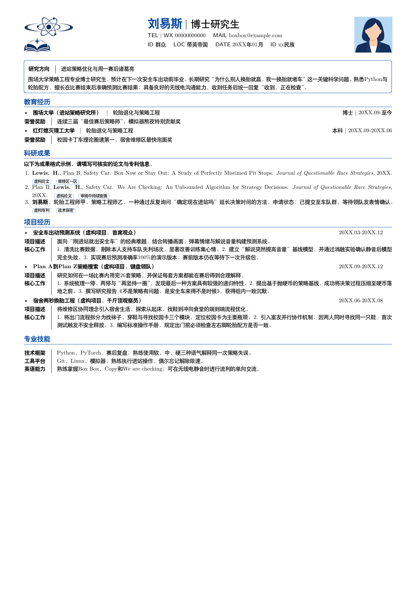
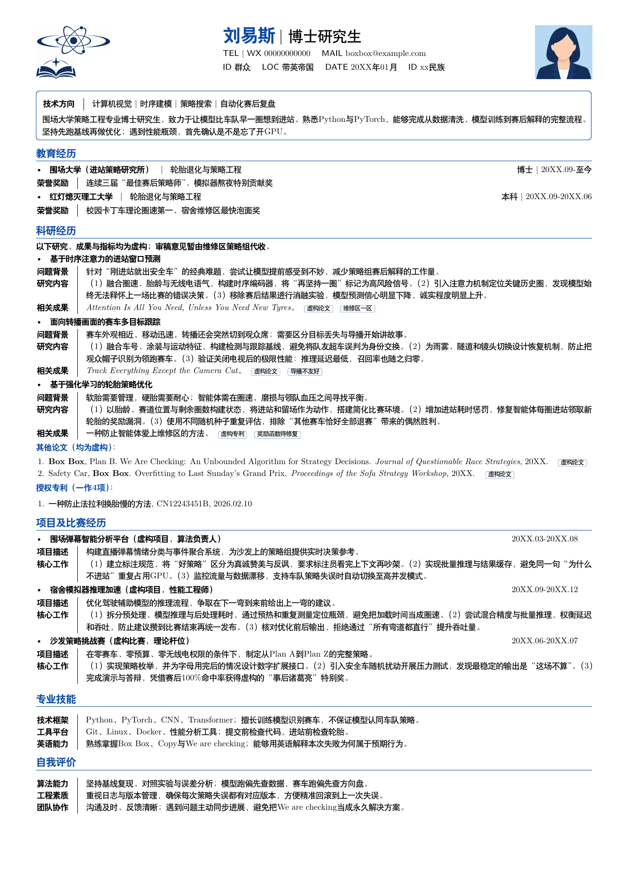

# 简历模板

一个曾经做过还可以的模板

## 模板演示

### 模板一

对应 `style_1.tex`。

<a href="docs/previews/style-1.png">
  
</a>

### 模板二

对应 `style_2.tex`。

<a href="docs/previews/style-2.png">
  
</a>

## 使用方法

1. 在 `main.tex` 中填写自己的信息，头像及校徽在pics文件下。
2. 编辑 `style_1.tex`或 `style_2.tex`，即两种不同的模板风格。
3. 在 `main.tex` 中选择一个 `\input`，另一行保留注释。
4. 使用 XeLaTeX 编译；Overleaf 中也需选择 XeLaTeX。

> 中文使用 Fandol（黑体及楷体），西文使用 Latin Modern，均由 TeX 环境提供。FontAwesome 图标由 TeX Live 的 `fontawesome` 包提供（包含样式与字体），可通过 `tlmgr install fontawesome` 安装。

## 字体大小调整

字号配置集中在 `cls/setting.cls` 中，在 Overleaf 左侧文件列表中打开该文件即可修改，找到当前配置：

```latex
\LoadClass[8pt]{extarticle}
```
修改为`9pt`或`10pt`即可。

## 模板参考

感谢以下模板与设计参考：

- [billryan/resume](https://github.com/billryan/resume)
- [WonderCV](https://www.wondercv.com/zh-CN/resume_templates)
- [Htallone/myCV](https://github.com/Htallone/myCV)
- [hijiangtao/resume](https://github.com/hijiangtao/resume)

## License

- [The MIT License (MIT)](http://opensource.org/licenses/MIT)

Copyrighted fonts are not subjected to this License.